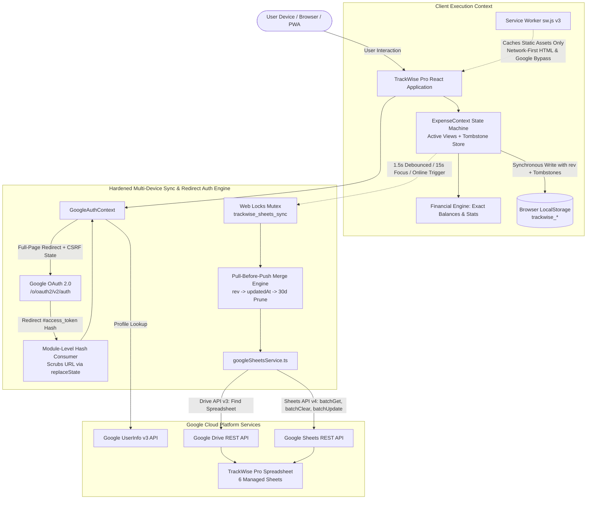

# Project Build & Architecture Document: TrackWise Pro

**Version:** 1.1.0  
**Last Updated:** November 2026  
**Author / Engineering Team:** TrackWise Pro Development Team  
**Status:** Production-Ready / Continuous Deployment  

---

## 1. Project Overview & Core Purpose

### 1.1 Executive Summary
**TrackWise Pro** is an open, modern, privacy-first personal finance tracking progressive web application (PWA). Engineered specifically around hybrid payment ecosystems (with first-class support for Indian UPI, cash, credit/debit cards, and bank transfers), TrackWise Pro eliminates user dependency on closed, subscription-gated third-party financial servers by adopting a **Local-First, Cloud-Synced Hybrid Architecture**.

### 1.2 Target Users & Market Positioning
- **Digital & Cash Transactors**: Users in hybrid cash/digital economies (specifically UPI users in India) who need transparent split tracking between virtual and physical wallets without rounding errors.
- **Privacy-Conscious Individuals**: Users who refuse to transmit sensitive financial ledgers, salary slips, and bank account credentials to proprietary fintech backends.
- **Cross-Device Mobile & Desktop Users**: Users requiring a lightweight, installable PWA that functions seamlessly across desktop browsers (Chrome, Opera, Edge, Brave, Safari), mobile browsers, and standalone PWA installations with resilient offline support.

### 1.3 Core Value Proposition
1. **True Data Ownership**: The application has no proprietary database backend. Data resides directly in the browser's persistent storage (IndexedDB with storage persistence lock) and synchronizes bidirectionally to a private spreadsheet on the user's personal Google Drive account.
2. **Instant Zero-Latency UI**: All ledger queries, analytics, category filters, and budget recalculations execute client-side in sub-millisecond timeframes.
3. **Automated Multi-Sheet Spreadsheet Architecture**: Syncs with Google Sheets via a structured 6-sheet schema (`Transactions`, `UPI Expenses`, `Cash Expenses`, `Budgets`, `Accounts`, `Recurring Bills`) allowing users to execute external analysis, pivot tables, or backups directly in Google Sheets.
4. **Direct Redirect Flow with PKCE S256 & CSRF Protection**: Uses Google's official OAuth 2.0 Authorization Code Flow (`response_type=code`) with PKCE (`code_challenge` / `code_verifier` S256) and CSRF `state` verification stored in `localStorage` with a 10-minute expiry—eliminating popup blockers, COOP (`Cross-Origin-Opener-Policy`) conflicts, and third-party cookie failures across desktop and mobile devices.
5. **XSS-Proof HttpOnly Cookies & Silent Token Refresh**: Refresh tokens are stored strictly inside an `HttpOnly; Secure; SameSite=Lax; Path=/api/auth` cookie (never accessible to JavaScript), auto-refreshed via `/api/auth/refresh` without hourly reconnect banners.
6. **Native iOS 16.4+ & Android PWA Direct Redirect Support**: Standalone Home Screen PWAs handle top-level OAuth navigation natively through in-app authentication sheets, persisting HttpOnly cookies and IndexedDB state directly inside the installed container without manual pairing codes.
7. **Live-Index Incremental Sync Engine**: Maps actual row positions dynamically from remote `values:batchGet` calls rather than caching static row indexes. Uses `values:batchUpdate` for modified rows, `values:append` for new entries, and executes zero remote writes if nothing changed.
8. **Asynchronous IndexedDB Storage with Account Isolation**: Namespaces local financial collections per user email (falling back to `guest` in offline mode) with `navigator.storage.persist()` to protect against Safari eviction.

---

## 2. Tech Stack & Dependencies

TrackWise Pro is constructed using a high-performance, strictly typed modern web stack with zero legacy runtime overhead.

### 2.1 Core Framework & Language
| Component | Technology | Version | Purpose |
| :--- | :--- | :--- | :--- |
| **Runtime & Bundler** | [Vite](https://vitejs.dev/) | `^6.0.3` | High-speed ESM dev server and optimized Rollup production bundler |
| **UI Framework** | [React](https://react.dev/) | `^18.3.1` | Component-driven declarative UI engine (StrictMode enabled) |
| **DOM Renderer** | React DOM | `^18.3.1` | Browser DOM rendering layer |
| **Language** | [TypeScript](https://www.typescriptlang.org/) | `^5.6.3` | Static typing, interface contracts, and compile-time correctness |
| **Vite React Plugin** | `@vitejs/plugin-react` | `^4.3.4` | Fast Refresh and JSX compilation |

### 2.2 Styling & Presentation
| Package | Version | Purpose |
| :--- | :--- | :--- |
| **CSS Framework** | [Tailwind CSS](https://tailwindcss.com/) | `^3.4.16` | Utility-first, mobile-responsive light/dark theme design system |
| **CSS Post-Processor** | [PostCSS](https://postcss.org/) | `^8.4.49` | Modern CSS transformation pipeline |
| **CSS Vendor Prefixer** | [Autoprefixer](https://github.com/postcss/autoprefixer) | `^10.4.20` | Cross-browser CSS ruleset optimization |
| **Class Merger** | [tailwind-merge](https://github.com/dcastil/tailwind-merge) | `^2.5.5` | Dynamic Tailwind class deduplication and conflict resolution |
| **Utility Helper** | [clsx](https://github.com/lukeed/clsx) | `^2.1.1` | Conditional class composition engine |

### 2.3 Visualization, Utilities & Icons
| Package | Version | Purpose |
| :--- | :--- | :--- |
| **Data Visualization** | [Recharts](https://recharts.org/) | `^2.15.0` | SVG-based responsive charting (Area, Bar, Pie, Radar charts) |
| **Iconography** | [Lucide React](https://lucide.dev/) | `^0.468.0` | Comprehensive financial, navigation, and state SVG icons |
| **Date Engine** | [date-fns](https://date-fns.org/) | `^4.1.0` | Lightweight, immutable date manipulation and formatting |
| **Micro-Interactions** | [canvas-confetti](https://github.com/catdad/canvas-confetti) | `^1.9.4` | Canvas-based celebratory particle FX for budget/goal milestones |

### 2.4 Cloud & External APIs
| Service / Endpoint | Version / URL | Purpose |
| :--- | :--- | :--- |
| **Google OAuth 2.0 Endpoint** | `https://accounts.google.com/o/oauth2/v2/auth` | Direct full-page redirect implicit authorization (`response_type=token`) |
| **Google Token Revocation** | `https://oauth2.googleapis.com/revoke` | Best-effort REST token revocation on sign-out |
| **Google UserInfo API** | `https://www.googleapis.com/oauth2/v3/userinfo` | Authenticated Google user profile & avatar retrieval |
| **Google Drive API** | `v3` | Spreadsheet file discovery, metadata validation, and workbook lookup |
| **Google Sheets API** | `v4` | Workbook creation, `ensureSheetsExist`, `values:batchGet`, and atomic `values:batchUpdate` |
| **Web Service Worker** | Cache API (`trackwise-v3`) | Static asset caching (stale-while-revalidate), network-first HTML navigation, and Google domain bypass |

---

## 3. Directory & File Structure

The project follows a modular, feature-oriented structure separating state contexts, service clients, reusable components, and utility libraries.

```
c:\Users\kitch\OneDrive\Documents\Expense Tracker\
├── .env                              # Local environment variables (VITE_GOOGLE_CLIENT_ID)
├── .env.example                      # Documented template for environment setup
├── .gitignore                        # Git exclusion rules (node_modules, dist, .env)
├── index.html                        # HTML5 SPA entry point, zero-flash theme script, splash screen
├── package.json                      # Dependency manifests, scripts, and build configuration
├── package-lock.json                 # Pinned dependency lockfile
├── postcss.config.js                 # PostCSS plugin registration (Tailwind, Autoprefixer)
├── PROJECT_DOCS.md                   # Complete Project Build & Architecture Document
├── README.md                         # Project introduction and quick-start instructions
├── tailwind.config.js                # Design tokens, color palette, animations, and container specs
├── tsconfig.json                     # TypeScript compiler options and strictness rules
├── vite.config.ts                    # Vite dev server (port 5173) & Rollup manual chunk splitting
│
├── public/                           # Static production assets
│   ├── apple-touch-icon.png          # iOS home screen web-clip icon
│   ├── favicon.svg                   # Vector SVG browser tab favicon
│   ├── icon-192.png                  # Standard 192x192 PWA launcher icon
│   ├── icon-512.png                  # High-density 512x512 PWA splash icon
│   ├── manifest.json                 # Web App Manifest (PWA installation metadata)
│   └── sw.js                         # Service Worker v3 (network-first HTML, Google API bypass, asset cache)
│
└── src/                              # Application source tree
    ├── App.tsx                       # Master root orchestrator (Tab routing, startup cloud pull, 1.5s debounce sync)
    ├── index.css                     # Global Tailwind directives, scrollbar rules, custom utilities
    ├── main.tsx                      # React 18 StrictMode DOM mount point, ErrorBoundary & SW registration
    ├── registerServiceWorker.ts      # Service Worker lifecycle registration helper
    │
    ├── components/                   # Modular UI presentation and domain components
    │   ├── analytics/
    │   │   └── AnalyticsReports.tsx  # Advanced trends, category distributions, spending radar, bar charts
    │   ├── auth/
    │   │   └── LoginPortal.tsx       # Entry login gate with loading spinner, inline OAuth error banner & offline mode
    │   ├── budgets/
    │   │   └── BudgetManager.tsx     # Monthly budget limits, progress indicators, alert thresholds
    │   ├── common/
    │   │   ├── CategoryIcon.tsx      # Dynamic category icon resolver with fallback glyphs
    │   │   └── ErrorBoundary.tsx     # React component crash boundary with recovery UI
    │   ├── dashboard/
    │   │   └── OverviewDashboard.tsx # Executive finance view (Expandable cards, stacked UPI/Cash pills, charts)
    │   ├── layout/
    │   │   ├── Header.tsx            # Top bar (Currency pill, cloud sync status, no-referrer avatar + fallback, menu)
    │   │   └── Navbar.tsx            # Desktop navigation tabs / Mobile bottom sticky navigation bar
    │   ├── modals/
    │   │   ├── BudgetModal.tsx       # Create/edit budget allocation modal
    │   │   ├── CsvImportModal.tsx    # Drag-and-drop CSV parser and bulk transaction importer
    │   │   ├── ExportModal.tsx       # Filterable JSON/CSV ledger data export modal
    │   │   ├── RecurringModal.tsx    # Create/edit recurring bill subscription modal
    │   │   └── TransactionModal.tsx  # Create/edit income/expense entry modal
    │   ├── recurring/
    │   │   └── RecurringManager.tsx  # Recurring bills & subscription manager (Frequencies, due tracking)
    │   ├── settings/
    │   │   └── SettingsView.tsx      # Categories, payment methods, Google Drive status, JSON/CSV backup & wipe
    │   └── transactions/
    │       └── TransactionList.tsx   # Paginated, filterable, multi-sort transaction ledger
    │
    ├── constants/
    │   └── defaults.ts               # Default categories, payment methods, icons, colors, and initial seed datasets
    │
    ├── context/
    │   ├── ExpenseContext.tsx        # Central financial state machine (Transactions, exact balances, filters)
    │   └── GoogleAuthContext.tsx     # OAuth 2.0 Direct Redirect auth, CSRF state check, token expiry, Drive/Sheets sync
    │
    ├── services/
    │   └── googleSheetsService.ts    # REST client for Google Drive v3 & Google Sheets v4 API (6-sheet engine)
    │
    ├── types/
    │   └── index.ts                  # Canonical TypeScript interfaces, type unions, and API contracts
    │
    └── utils/
        ├── formatters.ts             # Currency (INR, decimal-accurate), date parsers, payment method normalizers
        └── storage.ts                # Namespaced LocalStorage persistence, seed guards, CSV/JSON encoders
```

---

## 4. System Architecture & Data Flow

TrackWise Pro utilizes a **Local-First, Dual-Tier Storage Architecture** paired with a **Popup-Free OAuth 2.0 Direct Redirect Flow**. User actions commit instantaneously to local state and `localStorage`, while an asynchronous synchronization engine debounces and pushes updates to Google Sheets in the background.

### 4.1 High-Level Architecture Diagram



### 4.2 End-to-End Authentication & Data Synchronization Lifecycle

1. **OAuth 2.0 Direct Redirect with PKCE (S256) & CSRF Verification**:
   - When the user clicks **"Sign in with Google"**, `GoogleAuthContext.tsx` generates:
     - Cryptographic CSRF `state` nonce
     - PKCE code pair (`code_verifier` and `code_challenge` SHA-256 base64url)
   - These are saved into `localStorage` (`trackwise_oauth_pkce`) with a strict **10-minute expiry window** so mobile PWAs returning from an external browser or Custom Tab never lose session state.
   - The browser redirects to `https://accounts.google.com/o/oauth2/v2/auth` with:
     - `response_type=code`
     - `redirect_uri=window.location.origin` (strictly origin, no trailing slash)
     - `scope=openid email profile https://www.googleapis.com/auth/drive.file`
     - `code_challenge`, `code_challenge_method=S256`, `prompt=consent`, `access_type=offline`
   - Because authentication uses top-level direct redirects, it eliminates popup blockers, COOP (`Cross-Origin-Opener-Policy`), `window.closed` polling errors, and third-party cookie restrictions across desktop, iOS Safari, and mobile PWAs.

2. **StrictMode-Safe Single-Use Code Consumption & Serverless Token Exchange**:
   - When Google redirects back to `${origin}/?code=...&state=...`, `consumeRedirectUrlParams()` runs immediately at module load:
     - Strips `?code=...&state=...` from the browser URL instantly via `window.history.replaceState`.
     - Validates returned `state` against `localStorage`, enforcing the 10-minute TTL.
     - Retrieves `code_verifier` and immediately wipes the PKCE session from `localStorage`.
   - A module-level `redeemedCodeSet` (`Set<string>`) guarantees that React 18 `<StrictMode>` double-mounting will **never** trigger duplicate `/api/auth/exchange` calls for the same single-use authorization code.
   - `/api/auth/exchange` exchanges the code with Google's token endpoint (`https://oauth2.googleapis.com/token`) using server-side `GOOGLE_CLIENT_SECRET`.
   - The returned `refresh_token` is saved in an **`HttpOnly; Secure; SameSite=Lax; Path=/api/auth`** cookie (max-age 180 days) rather than being exposed to browser JavaScript.
   - The ephemeral `access_token` is returned to the client and silently refreshed via `/api/auth/refresh` whenever `Date.now() >= expiresAt - 60000`, removing hourly reconnect banners entirely.

3. **Native iOS 16.4+ & Android PWA Authentication Architecture**:
   - Modern iOS (iOS 16.4+) and Android standalone Home Screen PWAs execute top-level redirects (`window.location.assign`) seamlessly inside native in-app authentication sheets.
   - Upon redirect completion, `HttpOnly` refresh cookies and local storage tokens are stored directly inside the isolated standalone container.
   - Tapping **"Sign in with Google"** works natively out-of-the-box across installed PWAs without requiring manual pairing codes or secondary devices.
   - For users browsing in Safari before installing, a subtle dismissible tip advises installing to the Home Screen and logging in directly for the best fullscreen experience.

4. **Live-Index Incremental Sync Engine & Mutex Web Locks**:
   - Every sync (`performSync`) acquires a cross-tab mutex via the browser **Web Locks API** (`navigator.locks.request('trackwise_sheets_sync', ...)`).
   - Inside the lock, `performSync` pulls remote rows first via `values:batchGet` and constructs a live `Map<id, actualSheetRowNumber>` directly from the pulled response (never relying on stale local row caches).
   - Local and remote records (`Transactions`, `Budgets`, `Recurring Bills`) are reconciled using monotonic `rev` precedence and `updatedAt` timestamps.
   - If nothing changed remotely (`!remoteChanged`), write calls are skipped entirely.
   - Only modified rows are updated at their live `actualSheetRowNumber` via `values:batchUpdate`, and brand-new rows are appended via `values:append`. `values:batchClear` + full rewrites are strictly reserved for initial setup or 30-day tombstone pruning.

---

## 5. Database Schema & Data Models

### 5.1 Browser Storage Keys (`localStorage` & `sessionStorage`)

#### Financial & App State Keys (`src/utils/storage.ts` & `index.html`)
*Note: `ExpenseContext.tsx` persists full arrays (including soft-delete tombstones) under these keys and exposes active-only filtered views (`!isDeleted`) to all UI components while exposing full arrays (`allTransactions`, `allBudgets`, `allRecurring`) to the sync engine.*

| Storage | Key Name | Type | Description |
| :--- | :--- | :--- | :--- |
| `localStorage` | `trackwise_transactions_v1` | `Transaction[]` | Full transaction ledger including `rev`, `updatedAt`, and soft-delete tombstones |
| `localStorage` | `trackwise_categories_v1` | `Category[]` | Custom and default category definitions with icons and colors |
| `localStorage` | `trackwise_payment_methods_v1` | `PaymentMethodItem[]` | Configured payment methods (UPI, Cash, Credit Card, Bank, etc.) |
| `localStorage` | `trackwise_budgets_v1` | `Budget[]` | Category budget caps including `rev`, `updatedAt`, and soft-delete tombstones |
| `localStorage` | `trackwise_recurring_v1` | `RecurringTransaction[]` | Subscriptions & bills including `rev`, `updatedAt`, and soft-delete tombstones |
| `localStorage` | `trackwise_settings_v1` | `UserSettings` | Currency formatting, notifications, and app preferences |
| `localStorage` | `trackwise_is_initialized_v1` | `'true'` | Guard flag preventing demo data from re-seeding after user wipes data |
| `localStorage` | `trackwise_theme` | `'dark' \| 'light'` | Persisted theme preference read before React mounts for zero-flash rendering |

#### Authentication & Cloud Sync Keys (`src/context/GoogleAuthContext.tsx`)
| Storage | Key Name | Type | Description |
| :--- | :--- | :--- | :--- |
| `localStorage` | `trackwise_google_user` | `GoogleUser` (JSON) | Cached Google user profile (`id`, `name`, `email`, `picture`) |
| `localStorage` | `trackwise_google_token` | `string` | Active OAuth 2.0 Bearer access token |
| `localStorage` | `trackwise_google_expires_at` | `string` (epoch ms) | Access token expiration timestamp (checked with 60s safety buffer) |
| `localStorage` | `trackwise_offline_mode` | `'true' \| 'false'` | Tracks whether user bypassed login into local-only offline mode |
| `localStorage` | `trackwise_sheet_id` | `string` | Linked Google Spreadsheet ID |
| `localStorage` | `trackwise_sheet_url` | `string` | Direct Google Sheets browser URL |
| `localStorage` | `trackwise_last_sync` | `string` (ISO 8601) | Timestamp of last completed cloud pull/push |
| `localStorage` | `trackwise_custom_client_id` | `string` | Legacy fallback Client ID (only used if `VITE_GOOGLE_CLIENT_ID` is empty) |
| `sessionStorage` | `trackwise_oauth_state` | `string` | Short-lived CSRF nonce validated on OAuth redirect callback |

### 5.2 Google Sheets 6-Tab Workbook Schema

The application creates and maintains a dedicated Google Sheets workbook entitled **`TrackWise Pro - Personal Finance`**. Missing/empty `Rev` cells on legacy sheets automatically default to `1`.

#### Sheet 1: `Transactions` (`A1:L`, cleared on `A2:L`)
*Stores every historical transaction record including soft-delete tombstones and monotonic revision numbers.*
| Col | Field Name | Type | Description / Example |
| :--- | :--- | :--- | :--- |
| **A** | ID | `string` | Unique identifier (UUID or `tx_*`) |
| **B** | Date | `string` | ISO 8601 Date (`YYYY-MM-DD`) |
| **C** | Title | `string` | Transaction description (e.g., "Grocery Shopping") |
| **D** | Type | `string` | `expense` \| `income` |
| **E** | Category ID | `string` | Category ID (e.g., `cat_groceries`) |
| **F** | Amount | `number` | Monetary value with full decimal precision (`450.50`) |
| **G** | Payment Method | `string` | `UPI` \| `Cash` \| `Credit Card` \| `Debit Card` \| `Net Banking` |
| **H** | Notes | `string` | Optional descriptive context |
| **I** | Tags | `string` | Semicolon-separated tags (`"food;weekend"`) |
| **J** | Updated At | `string` | ISO timestamp of last modification |
| **K** | Is Deleted | `boolean` | Soft-delete tombstone flag (`FALSE` / `TRUE`) |
| **L** | Rev | `number` | Monotonic revision counter (`1`, `2`, `3`...) |

#### Sheet 2: `UPI Expenses` (`A1:G`, cleared on `A2:H`)
*Auto-filtered active view containing only non-deleted UPI expenses, with a dynamic `=SUMIFS` total.*
- **Header (Row 1)**: `Date`, `Title`, `Category ID`, `Amount`, `Notes`, `Tags`, `Updated At`
- **Rows 2..N**: Active expense records where `isDeleted === false` and `paymentMethod === 'UPI'`
- **Footer Row**: Labelled **"TOTAL UPI EXPENSES"** with dynamic formula:
  `=SUMIFS(Transactions!F2:F, Transactions!D2:D, "expense", Transactions!G2:G, "UPI", Transactions!K2:K, FALSE)`

#### Sheet 3: `Cash Expenses` (`A1:G`, cleared on `A2:H`)
*Auto-filtered active view containing only non-deleted Liquid Cash expenses, with a dynamic `=SUMIFS` total.*
- **Header (Row 1)**: `Date`, `Title`, `Category ID`, `Amount`, `Notes`, `Tags`, `Updated At`
- **Rows 2..N**: Active expense records where `isDeleted === false` and `paymentMethod === 'Cash'`
- **Footer Row**: Labelled **"TOTAL CASH EXPENSES"** with dynamic formula:
  `=SUMIFS(Transactions!F2:F, Transactions!D2:D, "expense", Transactions!G2:G, "Cash", Transactions!K2:K, FALSE)`

#### Sheet 4: `Budgets` (`A1:G`, cleared on `A2:I`)
*Configured monthly spending limits, alert thresholds, tombstones, and revisions.*
| Col | Field Name | Type | Description / Example |
| :--- | :--- | :--- | :--- |
| **A** | ID | `string` | Budget record ID |
| **B** | Category ID | `string` | Category identifier |
| **C** | Monthly Limit | `number` | Monthly budget ceiling |
| **D** | Alert Threshold | `number` | Percentage warning threshold (e.g., `80`) |
| **E** | Updated At | `string` | ISO timestamp |
| **F** | Is Deleted | `boolean` | Soft-delete tombstone flag (`FALSE` / `TRUE`) |
| **G** | Rev | `number` | Monotonic revision counter (`1`, `2`, `3`...) |

#### Sheet 5: `Accounts` (`A1:D`, cleared on `A2:D`)
*Live account summary recomputed directly from merged active transactions.*
- **Header (Row 1)**: `Wallet / Account`, `Live Balance`, `Currency`, `Last Synced (UTC)`
- **Row 2**: `UPI / Online Wallet`, `[Reconciled Net UPI Balance]`, `₹`, `[ISO Timestamp]`
- **Row 3**: `Liquid Cash Wallet`, `[Reconciled Net Cash Balance]`, `₹`, `[ISO Timestamp]`
- **Row 4**: `Total Net Balance`, `[UPI Balance + Cash Balance]`, `₹`, `[ISO Timestamp]`

#### Sheet 6: `Recurring Bills` (`A1:N`, cleared on `A2:N`)
*Subscription tracker and repeating bill definitions with monotonic revision tracking and tombstones.*
| Col | Field Name | Type | Description / Example |
| :--- | :--- | :--- | :--- |
| **A** | ID | `string` | Unique bill identifier |
| **B** | Title | `string` | Subscription name (e.g., "Netflix Premium") |
| **C** | Amount | `number` | Recurring cost with decimal precision (`649.00`) |
| **D** | Type | `string` | `expense` \| `income` |
| **E** | Category ID | `string` | Category identifier (`cat_utilities`) |
| **F** | Payment Method | `string` | Assigned payment method (`UPI`, `Cash`, etc.) |
| **G** | Frequency | `string` | `daily` \| `weekly` \| `monthly` \| `yearly` |
| **H** | Next Due Date | `string` | ISO due date (`YYYY-MM-DD`) |
| **I** | Start Date | `string` | ISO start date (`YYYY-MM-DD`) |
| **J** | Active | `boolean` | `TRUE` / `FALSE` |
| **K** | Notes | `string` | Optional notes/reminders |
| **L** | Rev | `number` | Monotonic revision counter (`1`, `2`, `3`...) |
| **M** | Updated At | `string` | ISO timestamp of last modification |
| **N** | Is Deleted | `boolean` | Soft-delete tombstone flag (`FALSE` / `TRUE`) |

---

## 6. Core Features & Implementation Details

### 6.1 Executive Dashboard (`src/components/dashboard/OverviewDashboard.tsx`)
- **Expandable Metrics Cards (Mobile & Desktop)**:
  - *Net Savings Card*: Displays net savings, savings rate, and vertically stacked **UPI** and **Cash** balance pills with exact decimal precision (`tabular-nums`, zero rounding, zero horizontal text overlap on compact mobile screens). Expandable on mobile to inspect wallet breakdowns.
  - *Total Income Card*: Displays aggregated period income; expands on click in both mobile and desktop views to show an itemized breakdown of every income source.
  - *Total Expenses Card*: Displays aggregated period expenses; expands on click to list every expense item.
  - *Top Category Card*: Highlights the highest spending category; expands on click to show all expenses in that category.
- **Dynamic Cash Flow Chart**: Recharts `AreaChart` rendering income versus expenses across periods.
- **Category Spend Distribution**: Recharts `PieChart` / `DonutChart` displaying proportional spend breakdown.
- **Recent Activity Ledger**: Quick-access list of recent transactions with inline edit/delete controls.

### 6.2 Transaction Management (`src/components/transactions/TransactionList.tsx` & `TransactionModal.tsx`)
- **Advanced Filtering Engine**: Filter across search keywords, transaction types (`all`, `income`, `expense`), categories, payment methods, and date ranges.
- **Multi-Field Sorting & Pagination**: Sort by date, amount, title, or category; paginate large ledgers smoothly.
- **Decimal-Accurate Monetary Input**: Preserves exact paise/cents across input, storage, dashboard cards, and Google Sheets sync.
- **Tagging & Notes**: Structured metadata tags and notes per transaction.

### 6.3 Budgeting & Financial Guardrails (`src/components/budgets/BudgetManager.tsx` & `BudgetModal.tsx`)
- **Dynamic Progress Meters**: Color-coded utilization bars (`< 70%` Emerald, `70%–90%` Amber, `> 90%` Rose).
- **Threshold Alerts & Milestones**: Visual warning badges when spending approaches ceilings, plus `canvas-confetti` celebration feedback.

### 6.4 Recurring Bills & Subscriptions (`src/components/recurring/RecurringManager.tsx` & `RecurringModal.tsx`)
- **Frequency Scheduling**: Supports `weekly`, `monthly`, `quarterly`, and `yearly` recurrences with due-date countdowns and header overdue badges.
- **One-Click Settlement**: Logs a recurring bill directly as a transaction and advances `nextDueDate`.
- **Full Cloud Sync**: Syncs bidirectionally with the dedicated `'Recurring Bills'` Google Sheet tab across devices.

### 6.5 Financial Analytics & Reporting (`src/components/analytics/AnalyticsReports.tsx`)
- **Income vs. Expense Comparison**: Multi-month bar charts and cash flow visualizations.
- **Category Radar & Savings Rate Trends**: Spending profile breakdown and monthly retention tracking.

### 6.6 Header, Navigation & Resilient Avatars (`src/components/layout/Header.tsx` & `Navbar.tsx`)
- **Cloud Sync Status Pill**: Displays live states (`Synced`, `Syncing...`, `Reconnect` on token expiry, or `Sign in to Backup` in offline mode).
- **Resilient Google Profile Avatars**: Renders user photos with `referrerPolicy="no-referrer"` (preventing Google CDN `403` blocks) and automatic `onError` fallback to an initial badge in both `Header.tsx` and `SettingsView.tsx`.
- **Global Shortcuts**: Keyboard shortcuts (`N` or `Ctrl/Cmd+K`) open the Add Transaction modal from anywhere.

### 6.7 Data Portability & Settings (`src/components/settings/SettingsView.tsx`, `CsvImportModal.tsx`, `ExportModal.tsx`)
- **CSV Bulk Import & Export**: Client-side CSV parser for imports and instant `.csv` / `.json` snapshot exports.
- **Locked Production OAuth Config**: The custom Client ID input is intentionally omitted from Settings UI so users cannot break cloud sync by misconfiguring credentials.
- **Clean Data Wipe**: Permanently wipes local transactions while setting `trackwise_is_initialized_v1` so demo seed data does not automatically reappear.

---

## 7. Environment Variables, Configuration & Build Setup

### 7.1 Environment Variables
All client-exposed environment variables use the `VITE_` prefix:

```ini
# .env.example
# Google Cloud Console OAuth 2.0 Client ID (Web Application type)
VITE_GOOGLE_CLIENT_ID=your-google-client-id.apps.googleusercontent.com
```

> **Security Note:** The Google OAuth Client ID is a public client identifier. Token issuance is strictly restricted by Google Cloud Console's **Authorized JavaScript Origins** and **Authorized Redirect URIs** rules.

#### Required Google Cloud Console OAuth Settings:
- **Application Type**: Web application
- **Authorized JavaScript Origins** (no trailing slash `/`):
  - `http://localhost:5173`
  - `http://localhost:5174`
  - `https://trackwise-git-main-pranav-28ae.vercel.app`
  - `https://trackwise-ruddy.vercel.app`
- **Authorized Redirect URIs** (Required for Direct Redirect Flow, no trailing slash `/`):
  - `http://localhost:5173`
  - `http://localhost:5174`
  - `https://trackwise-git-main-pranav-28ae.vercel.app`
  - `https://trackwise-ruddy.vercel.app`
- **OAuth Consent Screen**:
  - Add your Gmail address(es) under **Test users** while in Testing mode, or click **Publish App** for general access.
- **Enabled APIs in GCP Console**:
  1. Google Drive API
  2. Google Sheets API

### 7.2 Local Development Setup

#### Prerequisites
- Node.js `v18.0.0` or higher (Node.js 20+ recommended)
- npm `v9.0.0` or higher

#### Step-by-Step Installation
```bash
# 1. Clone repository
git clone https://github.com/pranavtvarshan-stack/trackwise.git
cd trackwise

# 2. Install dependencies
npm install

# 3. Configure environment
cp .env.example .env
# Edit .env and set VITE_GOOGLE_CLIENT_ID

# 4. Start local development server
npm run dev
```
The dev server starts on strict port `http://localhost:5173/`.

### 7.3 Build & Code Splitting Optimization

`vite.config.ts` splits heavy vendor dependencies into dedicated cacheable chunks via Rollup's functional `manualChunks`:

```typescript
// vite.config.ts
build: {
  rollupOptions: {
    output: {
      manualChunks(id) {
        if (id.includes('node_modules')) {
          if (id.includes('recharts') || id.includes('d3')) {
            return 'vendor-charts';
          }
          if (id.includes('lucide-react')) {
            return 'vendor-icons';
          }
          return 'vendor';
        }
      }
    }
  },
  chunkSizeWarningLimit: 900
}
```

#### Production Build Command
```bash
# Type check and build optimized production bundle
npm run build
```
Emitted `/dist` bundles:
- `dist/index.html` (~9.9 kB)
- `dist/assets/index-[hash].css` (~63.6 kB)
- `dist/assets/index-[hash].js` (~238.3 kB)
- `dist/assets/vendor-[hash].js` (~252.7 kB)
- `dist/assets/vendor-charts-[hash].js` (~332.3 kB)
- `dist/assets/vendor-icons-[hash].js` (~780.1 kB)

### 7.4 Deployment Configuration (Vercel)

Structured for zero-configuration continuous deployment on [Vercel](https://vercel.com):
- **Framework Preset**: Vite
- **Root Directory**: `./`
- **Build Command**: `npm run build`
- **Output Directory**: `dist`
- **Install Command**: `npm install`
- **Environment Variables**: Configure `VITE_GOOGLE_CLIENT_ID` in Vercel Project Settings → Environment Variables.

---

## 8. Current Status, Known Gaps & Next Steps

### 8.1 Completed Milestones
- [x] **XSS-Proof OAuth Authorization Code Flow (HttpOnly Refresh Cookie)**:
  - Backend serverless routes (`/api/auth/exchange`, `/api/auth/refresh`, `/api/auth/logout`) with 180-day HttpOnly cookie token storage.
  - Silent background token refresh (`getValidAccessToken()`) within 60 seconds of expiration, completely eliminating the hourly reconnect banner.
  - Dynamically loaded Google Identity Services (`initCodeClient`) with popup authorization and restricted `openid email profile https://www.googleapis.com/auth/drive.file` scope.
- [x] **Stateless Encrypted iOS PWA Pairing Handoff**:
  - Zero-serverless-memory handoff endpoint (`/api/auth/handoff`) using Node.js `crypto` AES-256-GCM keyed by `GOOGLE_CLIENT_SECRET` with 2-minute time-to-live (`exp > Date.now()`).
  - Seamless pairing between Safari browser sessions and standalone iOS PWA containers.
- [x] **Asynchronous IndexedDB Storage + Persistence Lock + Account Isolation**:
  - High-performance asynchronous storage layer (`idbStorage.ts`) powered by `idb` with per-user account isolation namespaced by user email (`guest` offline fallback).
  - Browser storage persistence locked via `navigator.storage.persist()` on app initialization.
  - Seamless zero-data-loss migration from legacy `localStorage` on initial startup; `localStorage` strictly reserved for lightweight UI flags (`trackwise_theme`, `trackwise_offline_mode`, `trackwise_is_initialized_v1`).
- [x] **Live-Index Incremental Sync Engine (No Stale Row Caching)**:
  - Dynamically builds live row index maps (`Map<id, actualSheetRowNumber>`) from pulled `values:batchGet` responses.
  - Granular diff engine: updates modified rows via single-row `values:batchUpdate`, appends new rows via `values:append`, and completely skips all write calls when `!remoteChanged`.
  - Automatic 30-day tombstone purge with clean `values:batchClear` full rewrite strictly reserved for initial setup or tombstone pruning.
  - Dynamic `=SUMIFS` formulas and wallet balances refreshed atomically in `UPI Expenses`, `Cash Expenses`, and `Accounts`.
- [x] **PWA Optimization & Service Worker v4**:
  - `trackwise-v4` Service Worker with strict network-only bypass for all `/api/*` endpoints.
  - Clean PNG icons (`icon-192.png`, `icon-512.png`, `apple-touch-icon.png`) declared with separate `any` and `maskable` purposes, preventing launcher icon corruption on Android and iOS.
  - Removed static GIS script tag from `index.html`.

### 8.2 Production Deployment & Credentials Checklist
1. **Google Cloud Console OAuth 2.0 Credentials**:
   - In Google Cloud Console under **APIs & Services > Credentials > OAuth 2.0 Client IDs**:
     - **Authorized JavaScript origins**: `http://localhost:5173` (for local development) and `https://<your-vercel-domain>.vercel.app` (for production).
     - **Authorized redirect URIs**: `http://localhost:5173` and `https://<your-vercel-domain>.vercel.app`.
2. **Environment Variables**:
   - `VITE_GOOGLE_CLIENT_ID`: Public Google OAuth 2.0 Web Client ID.
   - `GOOGLE_CLIENT_SECRET`: Private client secret configured in `.env` (for local Vite dev) and in Vercel Project Settings → Environment Variables (for serverless token exchange and PWA pairing).

### 8.3 Recommended Next Steps & Roadmap
- **Multi-Currency & FX Conversion**: Support foreign currency transactions with automatic conversion to the user's base currency.
- **Biometric App Lock (WebAuthn)**: Optional device PIN / fingerprint lock for enhanced local privacy on shared devices.
- **Automated PDF Monthly Statements**: Export formatted monthly financial reports and tax-ready category summaries.

---
*End of Document. Updated to reflect current codebase architecture and production status.*