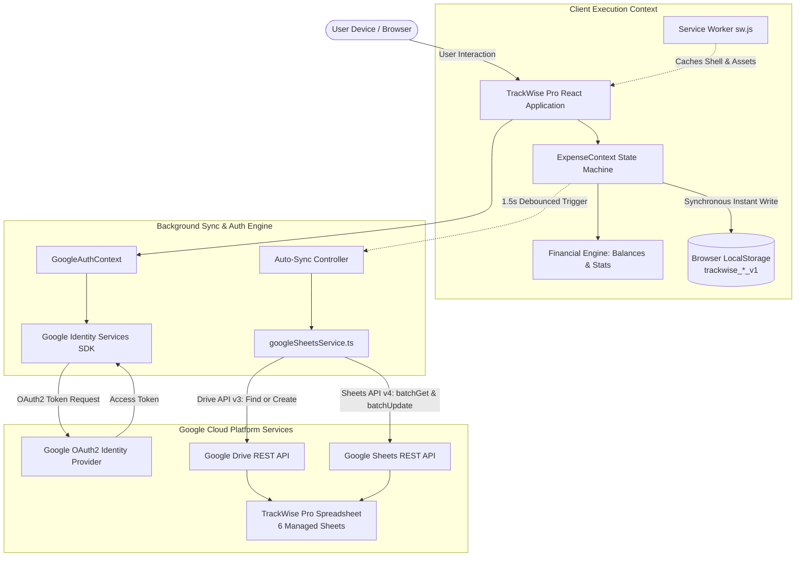

# Project Build & Architecture Document: TrackWise Pro

**Version:** 1.0.0  
**Last Updated:** November 2026  
**Author / Engineering Team:** TrackWise Pro Development Team  
**Status:** Production-Ready / Continuous Deployment  

---

## 1. Project Overview & Core Purpose

### 1.1 Executive Summary
**TrackWise Pro** is an open, modern, privacy-first personal finance tracking progressive web application (PWA). Engineered specifically around hybrid payment ecosystems (with first-class support for Indian UPI, cash, credit/debit cards, and bank transfers), TrackWise Pro eliminates user dependency on closed, subscription-gated third-party financial servers by adopting a **Local-First, Cloud-Synced Hybrid Architecture**.

### 1.2 Target Users & Market Positioning
- **Digital & Cash Transactors**: Users in hybrid cash/digital economies (specifically UPI users in India) who need transparent split tracking between virtual and physical wallets without rounding errors.
- **Privacy-Conscious Individuals**: Users who refuse to transmit sensitive financial ledgers, salary slips, and bank account credentials to proprietary fintech backends.
- **Cross-Device Mobile & Desktop Users**: Users requiring a lightweight, installable PWA that functions seamlessly on low-bandwidth connections, transitions into full offline mode, and synchronizes transparently when connected.

### 1.3 Core Value Proposition
1. **True Data Ownership**: The application has no proprietary database backend. Data resides directly in the browser's persistent storage and synchronizes bidirectionally to a private spreadsheet on the user's personal Google Drive account.
2. **Instant Zero-Latency UI**: All ledger queries, analytics, category filters, and budget recalculations execute client-side in sub-millisecond timeframes.
3. **Automated Multi-Sheet Spreadsheet Architecture**: Syncs with Google Sheets via a structured 6-sheet schema (`Transactions`, `UPI Expenses`, `Cash Expenses`, `Budgets`, `Accounts`, `Recurring Bills`) allowing users to execute external analysis, pivot tables, or backups directly in Google Sheets.
4. **Resilient Offline Capabilities**: Operates offline via Service Worker caching and local storage fallback, queuing pending changes until network and token availability are restored.

---

## 2. Tech Stack & Dependencies

TrackWise Pro is constructed using a high-performance, strictly typed modern web stack with zero legacy runtime overhead.

### 2.1 Core Framework & Language
| Component | Technology | Version | Purpose |
| :--- | :--- | :--- | :--- |
| **Runtime & Bundler** | [Vite](https://vitejs.dev/) | `^6.0.3` | High-speed ESM dev server and optimized Rollup production bundler |
| **UI Framework** | [React](https://react.dev/) | `^18.3.1` | Component-driven declarative UI engine |
| **DOM Renderer** | React DOM | `^18.3.1` | Browser DOM rendering layer |
| **Language** | [TypeScript](https://www.typescriptlang.org/) | `~5.6.2` | Static typing, interface contracts, and compile-time correctness |

### 2.2 Styling & Presentation
| Package | Version | Purpose |
| :--- | :--- | :--- |
| **CSS Framework** | [Tailwind CSS](https://tailwindcss.com/) | `^3.4.16` | Utility-first, mobile-responsive dark theme design system |
| **CSS Post-Processor** | [PostCSS](https://postcss.org/) | `^8.4.49` | Modern CSS transformation pipeline |
| **CSS Vendor Prefixer**| [Autoprefixer](https://github.com/postcss/autoprefixer) | `^10.4.20` | Cross-browser CSS ruleset optimization |
| **Class Merger** | [tailwind-merge](https://github.com/dcastil/tailwind-merge) | `^2.5.5` | Dynamic Tailwind class deduplication and conflict resolution |
| **Utility Helper** | [clsx](https://github.com/lukeed/clsx) | `^2.1.1` | Conditional class composition engine |

### 2.3 Visualization, Utilities & Icons
| Package | Version | Purpose |
| :--- | :--- | :--- |
| **Data Visualization** | [Recharts](https://recharts.org/) | `^2.15.0` | SVG-based responsive charting (Area, Bar, Pie, Radar charts) |
| **Iconography** | [Lucide React](https://lucide.dev/) | `^0.468.0` | Comprehensive financial, navigation, and state SVG icons |
| **Date Engine** | [date-fns](https://date-fns.org/) | `^4.1.0` | Lightweight, immutable date manipulation and formatting |
| **Micro-Interactions** | [canvas-confetti](https://github.com/catdad/canvas-confetti) | `^1.9.4` | Canvas-based celebratory particle FX for budget/goal milestones |

### 2.4 Cloud & External APIs
| Service / SDK | Version / Endpoint | Purpose |
| :--- | :--- | :--- |
| **Google Identity Services (GIS)** | `https://accounts.google.com/gsi/client` | OAuth2 implicit authorization token client |
| **Google Drive API** | `v3` | Spreadsheet file discovery, metadata validation, and automatic workbook creation |
| **Google Sheets API** | `v4` | Atomic `batchUpdate`, range metadata inspection, and cell value reading/writing |
| **Web Service Worker** | Cache API / Service Worker v1 | Asset caching, offline navigation fallback, and PWA installation |

---

## 3. Directory & File Structure

The project follows a modular, feature-oriented structure separating state contexts, service clients, reusable components, and utility libraries.

```
c:\Users\kitch\OneDrive\Documents\Expense Tracker\
├── .env                              # Local environment variables (VITE_GOOGLE_CLIENT_ID)
├── .env.example                      # Documented template for environment setup
├── .gitignore                        # Git exclusion rules (node_modules, dist, .env)
├── index.html                        # HTML5 single-page application entry point
├── package.json                      # Dependency manifests, scripts, and build configuration
├── package-lock.json                 # Pinned dependency lockfile
├── postcss.config.js                 # PostCSS plugin registration (Tailwind, Autoprefixer)
├── README.md                         # Project introduction and quick-start instructions
├── tailwind.config.js                # Design tokens, color palette, animations, and container specs
├── tsconfig.json                     # TypeScript compiler options and path configurations
├── tsconfig.app.json                 # Client application TypeScript rules
├── tsconfig.node.json                # Node/Vite build tooling TypeScript rules
├── vite.config.ts                    # Vite compilation config, code splitting, manual chunk specs
│
├── public/                           # Static production assets
│   ├── apple-touch-icon.png          # iOS home screen web-clip icon
│   ├── favicon.svg                   # Vector SVG browser tab favicon
│   ├── icon-192.png                  # Standard 192x192 PWA launcher icon
│   ├── icon-512.png                  # High-density 512x512 PWA splash icon
│   ├── manifest.json                 # Web App Manifest (PWA installation metadata)
│   └── sw.js                         # Production Service Worker for offline asset caching
│
└── src/                              # Application source tree
    ├── App.tsx                       # Master root orchestrator (Tab routing, cloud-pull init, debounce sync)
    ├── index.css                     # Global Tailwind directives, scrollbar rules, custom utilities
    ├── main.tsx                      # DOM mount point, context provider wrapping, SW registration
    ├── registerServiceWorker.ts      # Service Worker lifecycle registration helper
    │
    ├── components/                   # Modular UI presentation and domain components
    │   ├── analytics/
    │   │   └── AnalyticsReports.tsx  # Advanced trends, category distributions, spending radar, bar charts
    │   ├── auth/
    │   │   └── LoginPortal.tsx       # Standalone Google sign-in modal/portal
    │   ├── budgets/
    │   │   └── BudgetManager.tsx     # Monthly budget limits, progress indicators, alert thresholds
    │   ├── common/
    │   │   ├── CategoryIcon.tsx      # Dynamic category icon resolver with fallback glyphs
    │   │   └── ErrorBoundary.tsx     # React component crash boundary with recovery UI
    │   ├── dashboard/
    │   │   └── OverviewDashboard.tsx # Executive finance view (Expandable cards, charts, recent transactions)
    │   ├── layout/
    │   │   ├── Header.tsx            # Top application bar (Search, cloud sync badge, user profile)
    │   │   └── Navbar.tsx            # Desktop sidebar / Mobile bottom sticky tab navigation
    │   ├── modals/
    │   │   ├── BudgetModal.tsx       # Create/edit budget allocation modal
    │   │   ├── CsvImportModal.tsx    # Drag-and-drop CSV parser and bulk transaction importer
    │   │   ├── ExportModal.tsx       # Filterable JSON/CSV ledger data export modal
    │   │   ├── RecurringModal.tsx    # Create/edit recurring bill subscription modal
    │   │   └── TransactionModal.tsx  # Create/edit income/expense entry modal
    │   ├── recurring/
    │   │   └── RecurringManager.tsx  # Recurring bills & subscription manager (Frequencies, due tracking)
    │   ├── settings/
    │   │   └── SettingsView.tsx      # System preferences, Google OAuth setup, seed reset, cloud backup
    │   └── transactions/
    │       └── TransactionList.tsx   # Paginated, filterable, multi-sort transaction ledger
    │
    ├── constants/
    │   └── defaults.ts               # Default categories, icons, colors, and initial seed datasets
    │
    ├── context/
    │   ├── ExpenseContext.tsx        # Central financial state machine (Transactions, balances, filters)
    │   └── GoogleAuthContext.tsx     # Google Identity Services, token life cycle, Drive & Sheets sync
    │
    ├── services/
    │   └── googleSheetsService.ts    # REST client for Google Drive v3 & Google Sheets v4 API
    │
    ├── types/
    │   └── index.ts                  # Canonical TypeScript interfaces, type unions, and API contracts
    │
    └── utils/
        ├── formatters.ts             # Currency (INR), date string parsers, payment method normalizers
        └── storage.ts                # Namespaced LocalStorage persistence, seed loaders, CSV encoders
```

---

## 4. System Architecture & Data Flow

TrackWise Pro utilizes a **Local-First, Dual-Tier Storage Architecture**. User actions commit instantaneously to local state and LocalStorage, while an asynchronous synchronization engine debounces and pushes updates to Google Sheets in the background.

### 4.1 High-Level Architecture Diagram



### 4.2 End-to-End Data Synchronization Lifecycle

1. **Authentication Handshake**:
   - The user triggers Google Sign-In in `GoogleAuthContext.tsx`.
   - Google Identity Services (`initTokenClient`) launches a popup requesting scopes `spreadsheets`, `drive.file`, `userinfo.email`, and `userinfo.profile`.
   - The received OAuth2 token is stored in memory alongside an expiry timestamp (`Date.now() + expiresIn * 1000`).

2. **Spreadsheet Discovery & Provisioning**:
   - On the first cloud interaction, `googleSheetsService.findOrCreateSpreadsheet()` queries Google Drive API v3: `name = 'TrackWise Pro - Personal Finance' and mimeType = 'application/vnd.google-apps.spreadsheet' and trashed = false`.
   - If not found, a new spreadsheet is created with 6 sheets.
   - If found, `ensureSheetsExist()` inspects existing sheet titles and automatically provisions any missing sheets (such as `'Recurring Bills'`) via `AddSheetRequest`.

3. **Cloud Pull (Download)**:
   - On application startup or manual "Pull from Cloud", `pullFromGoogleSheets()` executes a single `batchGet` query across:
     - `'Transactions'!A2:K`
     - `'Budgets'!A2:H`
     - `'Recurring Bills'!A2:K`
   - Notice: Space-containing sheet names are wrapped in single quotes and URL-encoded (`encodeURIComponent("'Recurring Bills'!A2:K")`) to guarantee RFC-compliant HTTP execution.
   - Rows are mapped back into strongly typed TypeScript models. If the cloud workbook contains valid data, local state is populated and cached to `localStorage`.

4. **Optimistic Local Update & Debounced Push**:
   - Any transaction mutation (`addTransaction`, `editTransaction`, `deleteTransaction`) immediately modifies React state and persists to `localStorage`.
   - `App.tsx` monitors state revision timestamps and debounces synchronization by **1,500ms** to prevent API quota exhaustion during rapid multi-item entries.
   - `pushToGoogleSheets()` bundles:
     - Full transaction ledger into `'Transactions'!A1:K`
     - Computed UPI expense rows into `'UPI Expenses'!A1:G`
     - Computed Cash expense rows into `'Cash Expenses'!A1:G`
     - Active budget allocations into `'Budgets'!A1:H`
     - Real-time balances and timestamps into `'Accounts'!A1:D`
     - Subscriptions & bills into `'Recurring Bills'!A1:K`
   - The payload is dispatched via an atomic `values:batchUpdate` HTTP `POST` using `USER_ENTERED` value input option.

---

## 5. Database Schema & Data Models

### 5.1 Local Storage Namespaces (`localStorage`)

All persistent client keys are version-prefixed (`_v1`) to prevent collision with third-party web apps or legacy versions:

| Key Name | Type | Description |
| :--- | :--- | :--- |
| `trackwise_transactions_v1` | `Transaction[]` | Complete array of historical income and expense transactions |
| `trackwise_categories_v1` | `Category[]` | Custom and default category definitions with icons and colors |
| `trackwise_budgets_v1` | `Budget[]` | Category budget caps, period definitions, and alert triggers |
| `trackwise_recurring_v1` | `RecurringTransaction[]`| Configured subscriptions, bills, and frequencies |
| `trackwise_payment_methods_v1` | `PaymentMethodItem[]` | Enabled payment methods (UPI, Cash, Credit Card, Bank, etc.) |
| `trackwise_settings_v1` | `UserSettings` | User UI preferences, default currency, and sync parameters |
| `trackwise_google_sync_v1` | `GoogleSyncInfo` | Cloud spreadsheet ID, URL, last sync date, and sync status |
| `trackwise_custom_client_id_v1`| `string` | User-overridden Google Cloud OAuth Client ID |
| `trackwise_data_cleared_v1` | `boolean` | Flag preventing automatic re-seeding after explicit data wipe |

### 5.2 Google Sheets 6-Tab Workbook Schema

The application creates and maintains a dedicated Google Sheets workbook entitled **`TrackWise Pro - Personal Finance`**.

#### Sheet 1: `Transactions`
*Stores every historical transaction record.*
| Col | Field Name | Type | Description / Example |
| :--- | :--- | :--- | :--- |
| **A** | ID | `string` | Unique identifier (e.g., `tx_1731600000000_abc`) |
| **B** | Date | `string` | ISO 8601 Date (`YYYY-MM-DD`) |
| **C** | Title | `string` | Transaction description (e.g., "Grocery Shopping") |
| **D** | Type | `string` | `expense` \| `income` |
| **E** | Category | `string` | Category ID (e.g., `cat_groceries`) |
| **F** | Amount | `number` | Transaction monetary value with exact decimal precision (`450.50`) |
| **G** | Payment Method | `string` | `UPI` \| `Cash` \| `Credit Card` \| `Debit Card` \| `Net Banking` |
| **H** | Notes | `string` | Optional descriptive context |
| **I** | Tags | `string` | Comma-separated tags (e.g., `"food, weekend"`) |
| **J** | Updated At | `string` | ISO timestamp of last modification |
| **K** | Is Deleted | `boolean` | Soft-delete flag (`FALSE`) |

#### Sheet 2: `UPI Expenses`
*Auto-filtered view containing only expenses paid via UPI, plus dynamic summary totals.*
- **Header (Row 1)**: `Date`, `Title`, `Category`, `Amount`, `Notes`, `Tags`, `Updated At`
- **Rows 2..N**: All expense records where `paymentMethod === 'UPI'`
- **Footer Row**: `=SUM(D2:D[N])` labelled **"TOTAL UPI EXPENSES"**

#### Sheet 3: `Cash Expenses`
*Auto-filtered view containing only cash expense transactions, plus dynamic summary totals.*
- **Header (Row 1)**: `Date`, `Title`, `Category`, `Amount`, `Notes`, `Tags`, `Updated At`
- **Rows 2..N**: All expense records where `paymentMethod === 'Cash'`
- **Footer Row**: `=SUM(D2:D[N])` labelled **"TOTAL CASH EXPENSES"**

#### Sheet 4: `Budgets`
*Configured monthly spending limits and alert thresholds.*
| Col | Field Name | Type | Description / Example |
| :--- | :--- | :--- | :--- |
| **A** | ID | `string` | Budget record ID |
| **B** | Category | `string` | Category identifier |
| **C** | Limit Amount | `number` | Monthly budget ceiling |
| **D** | Period | `string` | `monthly` \| `yearly` |
| **E** | Alert Threshold | `number` | Percentage warning threshold (e.g., `80`) |
| **F** | Is Active | `boolean` | Enabled status (`TRUE` / `FALSE`) |
| **G** | Current Spend | `number` | Dynamic current period expenditure |
| **H** | Updated At | `string` | ISO timestamp |

#### Sheet 5: `Accounts`
*Live account summary providing immediate balance reconciliation.*
- **Header (Row 1)**: `Account Name`, `Current Balance`, `Currency`, `Last Updated`
- **Row 2**: `UPI Account`, `[Calculated Net UPI Balance]`, `INR`, `[ISO Timestamp]`
- **Row 3**: `Liquid Cash`, `[Calculated Net Cash Balance]`, `INR`, `[ISO Timestamp]`
- **Row 4**: `Total Net Balance`, `[Total Income - Total Expenses]`, `INR`, `[ISO Timestamp]`

#### Sheet 6: `Recurring Bills`
*Subscription tracker and repeating bill definitions.*
| Col | Field Name | Type | Description / Example |
| :--- | :--- | :--- | :--- |
| **A** | ID | `string` | Unique bill identifier |
| **B** | Title | `string` | Subscription name (e.g., "Netflix Premium") |
| **C** | Amount | `number` | Recurring cost with decimal precision (`649.00`) |
| **D** | Category | `string` | Category identifier (`cat_entertainment`) |
| **E** | Payment Method | `string` | Assigned payment method |
| **F** | Frequency | `string` | `monthly` \| `quarterly` \| `yearly` \| `weekly` |
| **G** | Due Date | `string` | ISO due date |
| **H** | Active | `boolean` | `TRUE` / `FALSE` |
| **I** | Notes | `string` | Notes/Reminders |
| **J** | Last Processed | `string` | Date of last generation or `""` |
| **K** | Updated At | `string` | ISO timestamp of modification |

---

## 6. Core Features & Implementation Details

### 6.1 Executive Dashboard (`src/components/dashboard/OverviewDashboard.tsx`)
- **Expandable Metrics Cards**: 
  - *Net Savings Card*: Displays current net savings and percentage savings rate. Features an internal vertical layout showing UPI and Cash balances with full decimal accuracy (avoiding text overlap on small mobile screens). Cards expand on click in mobile view to reveal detailed breakdown matrices.
  - *Total Income Card*: Displays aggregated period income; expands on click to reveal an itemized list of every contributing income stream.
  - *Total Expenses Card*: Displays aggregated period expenses; expands to display a full itemized list of expenditures.
  - *Top Category Card*: Identifies the highest spending category with visual icon indicators; expands to display all transactions attributed to that specific category.
- **Dynamic Cash Flow Chart**: Recharts `AreaChart` rendering income versus expenses across monthly or weekly buckets.
- **Category Spend Distribution**: Recharts `PieChart` / `DonutChart` showing proportional category breakdown with percentage tags.
- **Recent Activity Ledger**: Quick-access listing of recent entries with inline edit/delete actions.

### 6.2 Transaction Management (`src/components/transactions/TransactionList.tsx` & `TransactionModal.tsx`)
- **Advanced Filtering Engine**: Filter across search keywords, transaction types (`all`, `income`, `expense`), custom category selections, payment methods, and date ranges (7 days, 30 days, this month, custom interval).
- **Multi-Field Sorting**: Sort by date, amount, title, or category in ascending or descending direction.
- **Pagination & Batch Processing**: Configurable page sizes (10, 25, 50 items) with instant page transitions.
- **Decimal-Accurate Monetary Input**: Input handlers preserve floating-point currency numbers without premature integer truncation or rounding.
- **Tagging & Note Storage**: Supports structured metadata tags and unstructured notes per transaction.

### 6.3 Budgeting & Financial Guardrails (`src/components/budgets/BudgetManager.tsx` & `BudgetModal.tsx`)
- **Dynamic Progress Meters**: Visual progress bars color-coded by utilization:
  - `< 70%`: Emerald Green (Safe)
  - `70% - 90%`: Amber Yellow (Caution / Threshold Approaching)
  - `> 90%`: Rose Red (Critical / Over-Budget)
- **Visual Alert Banners**: Displays warning badges when expenses exceed custom alert thresholds.
- **Celebratory Milestone Trigger**: Integrated `canvas-confetti` bursts when a user completes a budget period under their spending ceiling.

### 6.4 Recurring Bills & Subscriptions (`src/components/recurring/RecurringManager.tsx` & `RecurringModal.tsx`)
- **Frequency Scheduling**: Supports `weekly`, `monthly`, `quarterly`, and `yearly` recurrences.
- **Due Date Countdown**: Highlights upcoming bills, overdue payments, and days remaining until renewal.
- **One-Click Bill Settlement**: Converts a recurring bill instance into a live transaction entry with automatic due-date advancement.
- **Cloud Synchronization**: Backed by the dedicated `'Recurring Bills'` sheet in Google Sheets.

### 6.5 Financial Analytics & Reporting (`src/components/analytics/AnalyticsReports.tsx`)
- **Income vs. Expense Trend Analysis**: Multi-month comparative bar charts.
- **Category Radar Chart**: Multi-axis spending profile across lifestyle, bills, food, transport, and utilities.
- **Monthly Savings Rate Progression**: Trendline monitoring personal financial retention over time.
- **Spending Velocity**: Tracks average daily burn rate across the active billing cycle.

### 6.6 Data Portability, Import & Export (`src/components/modals/CsvImportModal.tsx` & `ExportModal.tsx`)
- **CSV Import Engine**: Client-side drag-and-drop CSV parser with automatic column header detection (`Date`, `Title`, `Amount`, `Type`, `Category`, `Payment Method`).
- **Data Export Formats**: Instant client-side generation and download of formatted `.csv` and structured `.json` data archives.

### 6.7 Settings & Cloud Infrastructure Management (`src/components/settings/SettingsView.tsx`)
- **Google Sheets Integration Panel**: Connect/disconnect Google accounts, view linked spreadsheet URL, force manual Push/Pull, and inspect last sync timestamps.
- **Custom OAuth Client ID Configuration**: Allows advanced users to supply their own Google Cloud Console OAuth Client ID to avoid shared quota limits or origin mismatches.
- **Local Storage Management**: Reset to default sample dataset, wipe all data cleanly, or trigger manual JSON backup restore.

---

## 7. Environment Variables, Configuration & Build Setup

### 7.1 Environment Variables
All client-exposed environment variables are prefixed with `VITE_` in compliance with Vite security standards.

```ini
# .env.example
# Google Cloud Console OAuth 2.0 Client ID (Web Application type)
# Must have Authorized JavaScript Origins matching your local and production domains
VITE_GOOGLE_CLIENT_ID=your-google-client-id.apps.googleusercontent.com
```

> **Security Note:** The Google Client ID is an open public identifier. However, OAuth token issuance is strictly gated by the Google Cloud Console **Authorized JavaScript Origins** configuration.

#### Required Google Cloud Console OAuth Settings:
- **Application Type**: Web application
- **Authorized JavaScript Origins**:
  - `http://localhost:5173` (Local development)
  - `http://127.0.0.1:5173` (Alternative local loopback)
  - `https://your-production-app.vercel.app` (Production deployment)
- **Authorized Redirect URIs**: Not required for GIS popup implicit flow (`gis_transform`).
- **Enabled Google APIs in GCP Console**:
  1. Google Drive API
  2. Google Sheets API

### 7.2 Local Development Setup

#### Prerequisites
- Node.js `v18.0.0` or higher (Node.js 20+ recommended)
- npm `v9.0.0` or higher (or pnpm / yarn)

#### Step-by-Step Installation
```bash
# 1. Clone repository
git clone https://github.com/your-username/trackwise-pro.git
cd trackwise-pro

# 2. Install dependencies
npm install

# 3. Configure environment
cp .env.example .env
# Edit .env and supply your VITE_GOOGLE_CLIENT_ID

# 4. Start local development server
npm run dev
```
The application will launch at `http://localhost:5173/`.

### 7.3 Build & Code Splitting Optimization

TrackWise Pro implements advanced Rollup manual chunking in `vite.config.ts` to ensure low initial bundle size and rapid Time-to-Interactive (TTI):

```typescript
// vite.config.ts snippet
build: {
  chunkSizeWarningLimit: 900,
  rollupOptions: {
    output: {
      manualChunks: {
        'vendor-charts': ['recharts', 'd3-shape', 'd3-path', 'd3-scale'],
        'vendor-icons': ['lucide-react'],
        'vendor': ['react', 'react-dom', 'date-fns', 'clsx', 'tailwind-merge', 'canvas-confetti'],
      },
    },
  },
}
```

#### Production Build Command
```bash
# Type check and build optimized bundle
npm run build
```
Build output is emitted to the `/dist` directory:
- `dist/assets/index-[hash].js`: Application shell and state controllers
- `dist/assets/vendor-[hash].js`: React core and standard utilities
- `dist/assets/vendor-charts-[hash].js`: Recharts and D3 dependencies
- `dist/assets/vendor-icons-[hash].js`: Lucide icon vectors
- `dist/assets/index-[hash].css`: Compiled Tailwind styling ruleset

### 7.4 Deployment Configuration (Vercel)

The project is structured for zero-configuration continuous deployment on [Vercel](https://vercel.com):
- **Framework Preset**: Vite
- **Root Directory**: `./`
- **Build Command**: `npm run build`
- **Output Directory**: `dist`
- **Install Command**: `npm install`
- **Environment Variables**: Add `VITE_GOOGLE_CLIENT_ID` in Vercel Project Settings > Environment Variables.

---

## 8. Current Status, Known Gaps & Next Steps

### 8.1 Completed Milestones
- [x] Complete TypeScript-enforced financial data engine with LocalStorage caching.
- [x] Google Drive API v3 & Google Sheets API v4 integration using Google Identity Services (GIS).
- [x] Dedicated 6-Sheet Google Spreadsheet synchronization (`Transactions`, `UPI Expenses`, `Cash Expenses`, `Budgets`, `Accounts`, `Recurring Bills`).
- [x] Decimal-accurate currency representation for UPI and Cash balances across all summary widgets.
- [x] Responsive layout with expandable detail cards for mobile and desktop viewports.
- [x] PWA offline caching via Service Worker (`sw.js`) and Web App Manifest (`manifest.json`).
- [x] Data import/export routines (CSV parser and JSON ledger backup).

### 8.2 Known Gaps & Technical Considerations
1. **OAuth Token Lifespan & Refresh Handling**:
   - Google Identity Services token client provides access tokens with a 3,600-second (1 hour) expiration. 
   - *Current Behavior*: If an expired token is detected during sync, the UI prompts the user to re-authenticate or re-trigger sign-in.
   - *Improvement*: Implement silent background token refresh via GIS `prompt: ''` when the user has an active Google session.
2. **Conflict Resolution Strategy**:
   - *Current Behavior*: Synchronization operates on a "Last Push Wins" strategy during automated debounced updates, and a "Cloud Overrides Local" strategy on manual Pull.
   - *Improvement*: Introduce a vector clock or field-level conflict reconciliation UI when modifications occur concurrently across two disconnected offline devices.
3. **Bi-directional Cell Formula Preservation**:
   - *Current Behavior*: `pushToGoogleSheets` rewrites data rows while re-injecting `=SUM(...)` formulas into summary sheets.
   - *Improvement*: Maintain named ranges in Google Sheets so users can add custom pivot sheets that reference raw data without risking overwrite.

### 8.3 Recommended Next Steps & Roadmap
- **SMS / Push-Notification Expense Ingestion**: Integrate Web Notification and SMS Receipt regex parsers for automated UPI spend detection on Android devices.
- **Multi-Currency & Real-Time FX Conversion**: Allow transactions in foreign currencies (USD, EUR, GBP) with automatic conversion back to base INR or USD.
- **Biometric WebAuthn Unlock**: Add fingerprint / FaceID app lock support using the Web Authentication API (`navigator.credentials`) for enhanced on-device privacy.
- **Export to PDF & Tax Computation**: Generate annual financial summary statements and income tax category expense schedules.

---
*End of Document. Generated automatically by Antigravity Technical Audit.*
